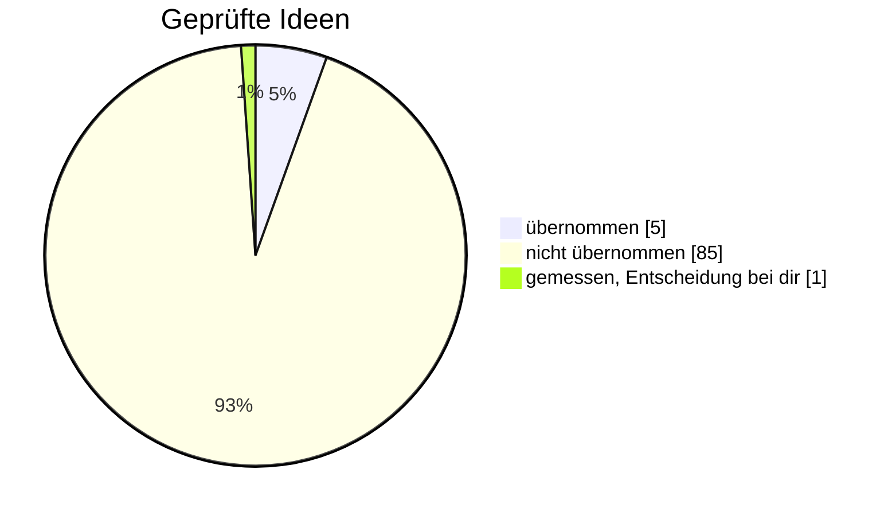

# 🔬 Was der Bot schon weiß

Stand: 24.11.2026 · Simulation mit Spielgeld, keine Anlageberatung.

Alle Ideen, die mit echten Kursen geprüft wurden, auf einen Blick. Diese Notiz ändert der Bot nie. Zurück zur [[Start|Startseite]] · neue Ideen des Forschungs-Bots: [[Notizen/Forschung – Tagebuch]] · was der Bot aus den eigenen Trades lernt: [[Lehren]].

> [!tip] So wird geprüft
> - **3 Zeiträume** (2010–2014, 2015–2021, 2022–2026) × **2 Aktiengruppen** (Watchlist und 60 andere Aktien) = 6 Fälle.
> - Jeder Fall läuft **16-mal** mit zufälliger Reihenfolge der Aktien, immer mit Gebühr und Spread.
> - **Übernommen wird nur, was überall hilft oder zumindest nirgends erkennbar schadet.**
> - **Pkt** = Prozentpunkte Rendite pro Jahr im Vergleich zum Bot ohne die Idee.

> [!info] 🛡️ Neue Regeln nur geprüft
> Eine Idee kommt erst nach diesem Test und deinem „Ja“ zum Pull Request in den Bot. Der Sicherheits-Check bei GitHub zeigt jede Änderung an den Kaufregeln an.

> [!warning] ⚠️ Ehrliche Messung vom 06.11.2026
> Alle Rückblicke hier laufen mit der heutigen Watchlist – und die ist mit dem Wissen von heute gewählt. Mit 24 zufälligen Aktien, die damals im S&P 500 waren, brachte der unveränderte Bot nur **+11,6 / +3,2 / +3,3 %** im Jahr statt +13,3 / +11,9 / +8,1 %. Dieselben Aktien einfach zu halten brachte mehr (+11 bis +23 %, aber mit Rückgängen bis −38 %). Der echte Vorteil der Regeln ist also klein. Die Vergleiche zwischen Ideen (Pkt) bleiben gültig, die Höhe der Rendite nicht. Details: [[Notizen/Forschung – Tagebuch]].

## ✅ Steckt im Bot

| Idee | Warum |
| --- | --- |
| Stop und Ziel näher (Ziel nicht weiter weg als der Stop) | Trefferquote überall höher (etwa 45 % → 57 %), Rückgänge überall kleiner. Dafür bringt ein Treffer weniger. |
| Höchstens 2 Positionen je Branche | +0,4 Pkt, in 5 von 6 Fällen besser, Rückgang nie größer |
| Trendlinien-Ausbruch als 9. Kauf-Strategie (seit 06.11.2026) | **Auf Wunsch des Besitzers**, nicht weil der Test es zeigt: −0,5 / +0,7 / +0,4 Pkt, im Bereich des Zufalls. Bewährt sie sich nicht, pausiert sie die Lernregel von selbst. |
| Lernregel behalten (schlecht laufende Strategien pausieren) | Ganz ohne war es in 4 von 6 Fällen schlechter, eine ruhigere Regel kostete 0,5–0,9 Pkt |
| Shorts aus | Alle Short-Strategien verlieren, auch zehn verbesserte Varianten – und auch auf fairen Zufallslisten aus dem damaligen S&P 500 (18.11.2026: −2,2 / −0,2 / 0,0 Pkt, Ø −0,48 bis −0,13 R je Short) |

## ❌ Geprüft und nicht übernommen

| Idee | Ergebnis | Mehr dazu |
| --- | --- | --- |
| Weniger Strategien | nur 2 Strategien: −5 Pkt; alle 8 liegen über 16 Jahre im Plus | README |
| Relative Stärke zuerst | leicht schlechter, nicht überall | README |
| Nur klare Signale, Chance-Risiko lernen | half höchstens bis 2021, danach nicht | README |
| Freies Geld im Nasdaq-100 parken | +2 bis +8 Pkt, aber Rückgang bis fast doppelt so groß | README |
| Kaufen nach guten Quartalszahlen | −0,3 Pkt, an 91 % der Tage kauft der Bot ohnehin schon | README |
| Risiko nach der Marktlage (VIX) | −0,6 Pkt | README |
| Gewinner laufen lassen | Rendite nur in der Hälfte der Fälle besser | [[Notizen/Gelernt – Stop nachziehen und absichern]] |
| Halb am Ziel verkaufen, Rest laufen lassen | −1,2 Pkt | [[Notizen/Gelernt – Stop nachziehen und absichern]] |
| Stop während des Trades anheben | −0,7 bis −2,6 Pkt | [[Notizen/Gelernt – Stop nachziehen und absichern]] |
| Verkaufen, wenn überhitzt | −0,9 bis −5,6 Pkt | [[Notizen/Gelernt – Stop nachziehen und absichern]] |
| Ziel-Chance (Black-Scholes) zuerst kaufen | ±0,0 Pkt | [[Notizen/Gelernt aus dem Optionsskript]] |
| Kerzen- und Chartmuster | −0,1 bis −4,1 Pkt | [[Notizen/Gelernt – Muster und Lehrbücher]] |
| Volumen (eigene Strategien oder Filter) | −0,5 bis −1,6 Pkt | [[Notizen/Gelernt – Muster und Lehrbücher]] |
| Lehrbuch-Ideen (ADX, Wochentrend, Fibonacci) | −3,5 bis +0,1 Pkt | [[Notizen/Gelernt – Muster und Lehrbücher]] |
| Mehr Aktien (84 statt 24) | in allen drei Zeiträumen schlechter | README |
| Mehr Positionen (bis 15) | mehr Rendite nur mit mehr Risiko, Rückgang bis 24 % statt 16 % | README |
| Hebel 1,5 bzw. 2 | +4 bzw. +7 Pkt, aber Rückgang etwa doppelt so groß | [[Notizen/Gelernt – Hebel und 4-Stunden-Kerzen]] |
| 4-Stunden-Kerzen statt Tageskerzen | +6,8 % → −1,6 % pro Jahr, doppelte Kosten | [[Notizen/Gelernt – Hebel und 4-Stunden-Kerzen]] |
| TradingView-Strategie „Chart-Muster (Volumen)“ (5-Minuten-Kerzen) | nur bei TSLA im Plus, mit allen 24 Aktien Gewinnfaktor 0,61 mit Gebühren | [[Notizen/Gelernt – Muster und Lehrbücher]] |
| Nachkaufen bei Rückgang, 80 % des Depots für neue Käufe | −0,3 bis −0,5 Pkt, Rückgang in bis zu 4 von 6 Fällen größer | [[Notizen/Gelernt – Nachkaufen, Teilverkauf und 15-Minuten-Chart]] |
| Teil verkaufen beim Markt-Rücksetzer, am Boden zurückkaufen | −0,4 bis +0,1 Pkt, 2022–2026 immer schlechter | [[Notizen/Gelernt – Nachkaufen, Teilverkauf und 15-Minuten-Chart]] |
| 15-Minuten-Wächter beim Verkauf (früher raus beim Drehen, am Ziel laufen lassen) | nirgends verlässlich besser, 2025 bis −3,6 Pkt | [[Notizen/Gelernt – Nachkaufen, Teilverkauf und 15-Minuten-Chart]] |
| Muster-Gedächtnis: ähnliche Charts aus der Vergangenheit (TikTok-Idee) | sagt nichts voraus, bestes Fünftel +0,07 R, schlechtestes +0,10 R | [[Notizen/Gelernt – Muster und Lehrbücher]] |
| Lernmodell: nur Signale mit guter Punktzahl kaufen oder beste zuerst (490.000 Signale, 518 Aktien, mit Bilanzdaten) | Trennschärfe 0,51 (Münzwurf 0,50); beste zuerst −3,1 bis +4,1 Pkt, nicht überall | [[Notizen/Gelernt – Lernmodell und Fehler-Analyse]] |
| Nicht bei jedem Schreck verkaufen (Stop erst zum Schluss, Panik-Regel, starke Aktien halten) | −1,2 bis −5,2 Pkt, nur „starke Aktien“ 2015–2021 +1,8 | [[Notizen/Gelernt – Lernmodell und Fehler-Analyse]] |
| Markt-Ampel aus dem Lernmodell (keine Käufe an schlechten Markttagen) | −0,8 bis +1,0 Pkt, Rückgang etwas kleiner, nicht überall | [[Notizen/Gelernt – Lernmodell und Fehler-Analyse]] |
| Signale am selben Tag vergleichen (Modell ohne Marktlage) | −0,2 bis +0,3 Pkt, Rückgang etwas größer | [[Notizen/Gelernt – Lernmodell und Fehler-Analyse]] |
| 7 statt 5 Positionen (seit 03.11.2026 auf deinen Wunsch trotzdem 7, Gesamtrisiko bleibt 5 %) | +0,2 Pkt; mit 7 % Gesamtrisiko +1,0 Pkt, aber Rückgang 17,9 % statt 14,2 % (in 6 von 6 Fällen größer) | [[Notizen/Gelernt – Lernmodell und Fehler-Analyse]] |
| Früher verkaufen, wenn ein Trade nach 5–12 Tagen keinen Schwung hat | −0,6 bis −5,7 Pkt, Rückgänge meist größer | [[Notizen/Gelernt – Lernmodell und Fehler-Analyse]] |
| Insider-Käufe (SEC) zuerst kaufen oder als Merkmal im Lernmodell | Regel +1,2 bis +1,3 Pkt, aber zufällig gewählte Signale schafften dasselbe; Modell nicht besser (0,503) | [[Notizen/Gelernt – Lernmodell und Fehler-Analyse]] |
| Lernmodell auch aus Aktien lernen lassen, die aus dem S&P 500 geflogen sind | beste zuerst 2010–2014 −2,5 Pkt; deren Signale liefen schlechter, das Modell erkennt sie nicht | [[Notizen/Gelernt – Lernmodell und Fehler-Analyse]] |
| Tagesbremse nach einem −2-%-Tag (Pause oder alles verkaufen) | −0,1 bis −1,9 Pkt, nur 3 Tage Pause 2015–2021 +1,2; weniger Risiko macht solche Tage seltener, kostet aber 2–3 Pkt | [[Notizen/Forschung – Tagebuch]] |
| Lernmodell mit klarerer Frage (Höhe von R, Ziel vor Stop) oder ein Modell je Strategie, beste zuerst | „Höhe von R“ +0,7 bis +4,3 Pkt und kleinere Rückgänge, aber zufällige Punktzahlen schafften teils dasselbe; Trennschärfe 0,50–0,52 | [[Notizen/Forschung – Tagebuch]] |
| Kosten-Filter: nur Ziele mindestens 3 % bzw. 5 % über dem Kurs | −1,0 bis +0,5 bzw. −3,2 bis −1,0 Pkt, im Bereich des Zufalls | [[Notizen/Forschung – Tagebuch]] |
| Ziel näher für 70–80 % Treffer | Treffer 65–79 %, aber Rendite −2,6 bis +5,6 % statt +7 bis +10,5 % | [[Notizen/Forschung – Tagebuch]] |
| Boden a: Stop 0,5 ATR unter den letzten Boden | −4,0 / +2,0 / +1,6 Pkt, 2010–2014 Rückgang −23 % statt −14 % | [[Notizen/Forschung – Tagebuch]] |
| Boden b: nur kaufen nah am Boden (≤ 1,5 ATR) | −6,5 bis −3,0 Pkt, nicht besser als zufälliges Auslassen | [[Notizen/Forschung – Tagebuch]] |
| Boden c: nicht kaufen nach gebrochenem Boden | −0,6 bis +1,4 Pkt, im Bereich des Zufalls | [[Notizen/Forschung – Tagebuch]] |
| Boden d: Ziel am nächsten Widerstand | −6,6 / +1,4 / +4,2 Pkt, Rückgänge größer | [[Notizen/Forschung – Tagebuch]] |
| Boden-Kauf a: neues Kauf-Signal am Abpraller (jede Unterstützung) | −0,1 / −0,6 / −1,1 Pkt, zufällige Zusatz-Käufe genauso gut | [[Notizen/Forschung – Tagebuch]] |
| Boden-Kauf b: Abpraller nur an starker Zone (mind. 2 Gründe) | −0,6 / −1,3 / ±0 Pkt, nicht besser als Zufall | [[Notizen/Forschung – Tagebuch]] |
| Eigenes Depot: Momentum 12 Monate, 10 Aktien (monatlich) | heutige Liste +26 bis +46 %, mit Stichtag nur +8 bis +26 %; Rückgang bis −36 %, weniger als Nasdaq halten | [[Notizen/Forschung – Tagebuch]] |
| Eigenes Depot: Momentum 6 Monate, 10 Aktien | mit Stichtag +9 bis +21 %, schlägt Zufall, aber Rückgang bis −37 % | [[Notizen/Forschung – Tagebuch]] |
| Eigenes Depot: Momentum 12 Monate, 20 Aktien | mit Stichtag +6 bis +19 %, nicht besser als Zufall | [[Notizen/Forschung – Tagebuch]] |
| Kombi: halb Swing-Bot, halb Momentum | mit Stichtag +8 bis +20 %, 2015–2026 weniger Rendite pro Rückgang als der Bot | [[Notizen/Forschung – Tagebuch]] |
| Branchen-Rotation (3 stärkste Branchen-ETFs) | +7 bis +15 %, nirgends mehr Rendite pro Rückgang als der Bot | [[Notizen/Forschung – Tagebuch]] |
| Nasdaq-100 nur über der 200-Tage-Linie halten | +13 bis +18 %, nur 2022–2026 mehr Rendite pro Rückgang als der Bot | [[Notizen/Forschung – Tagebuch]] |
| Ruhige Aktien (20 mit geringster Schwankung) | +6 bis +15 %, nicht besser als Zufall | [[Notizen/Forschung – Tagebuch]] |
| Watchlist nach Regel: 24 meistgehandelte S&P-500-Aktien | +10,3 / +3,3 / +4,0 %, nicht besser als zufällige Listen | [[Notizen/Forschung – Tagebuch]] |
| Watchlist nach Regel: 24 stärkste Aktien (12 Monate) | +6,2 / +2,8 / +4,0 %, schlechter als zufällige Listen | [[Notizen/Forschung – Tagebuch]] |
| Halb Bot, halb S&P 500 halten | besser als der Bot allein, aber weniger Rendite pro Rückgang als der S&P 500 allein | [[Notizen/Forschung – Tagebuch]] |
| Bot nur mit Gegenbewegung (einzige Strategie knapp besser als Zufallskäufe) | +3,4 / +1,5 / −1,1 % statt +12,7 / +4,7 / +2,5 % | [[Notizen/Forschung – Tagebuch]] |
| Kaufzeit: zum Schluss des Signaltags | −0,5 / +0,1 / −0,3 Pkt, Rückgänge größer | [[Notizen/Forschung – Tagebuch]] |
| Kaufzeit: zum Schluss des nächsten Tages | −1,2 / +0,5 / −1,0 Pkt | [[Notizen/Forschung – Tagebuch]] |
| Kaufzeit: zur Eröffnung nur ohne Lücke nach oben | +0,8 / +1,9 / −3,6 Pkt, 2022–2026 deutlich schlechter | [[Notizen/Forschung – Tagebuch]] |
| Day-Trader-Skill: Bullen-Flagge als Strategie | +1,3 / +1,1 / +0,2 Pkt, aber zufällige Zusatz-Käufe genauso gut | [[Notizen/Wissen – Day-Trader-Skill]] |
| Day-Trader-Skill: überverkauft (RSI 14 unter 30) als Strategie | −0,1 / +0,6 / +0,9 Pkt | [[Notizen/Wissen – Day-Trader-Skill]] |
| Day-Trader-Skill: Abpraller nach Überverkauft als Strategie | +0,3 / −0,6 / ±0,0 Pkt | [[Notizen/Wissen – Day-Trader-Skill]] |
| Day-Trader-Skill: 20-Tage-Schlusshoch-Ausbruch als Strategie | −0,9 / −0,4 / +0,3 Pkt | [[Notizen/Wissen – Day-Trader-Skill]] |
| Day-Trader-Skill: zurück über die 20-Tage-Linie als Strategie | −1,2 / +0,8 / ±0,0 Pkt | [[Notizen/Wissen – Day-Trader-Skill]] |
| Day-Trader-Skill: höchstens 3 Käufe am Tag | +0,9 / −1,0 / +1,4 Pkt | [[Notizen/Wissen – Day-Trader-Skill]] |
| Day-Trader-Skill: Chance-Risiko mindestens 1,0 | −2,2 / +0,2 / −0,1 Pkt | [[Notizen/Wissen – Day-Trader-Skill]] |
| Day-Trader-Skill: Zeitmaschine (1.000 Wiederholungen) als Filter | −2,6 / +0,9 / +2,4 Pkt | [[Notizen/Wissen – Day-Trader-Skill]] |
| Day-Trader-Skill: Geschichte der Regel je Aktie als Filter | −3,6 / −3,2 / +0,3 Pkt | [[Notizen/Wissen – Day-Trader-Skill]] |
| Day-Trader-Skill: Tageshandel (Ausbruch aus der Eröffnungsspanne) | −0,18 bis −0,30 R je Trade nach Spread, nicht besser als Zufalls-Einstiege | [[Notizen/Wissen – Day-Trader-Skill]] |
| Monatswechsel 1: nur an den letzten 4 Handelstagen des Monats kaufen | −1,8 / −5,1 / −5,2 Pkt, nicht besser als Zufall | [[Notizen/Forschung – Tagebuch]] |
| Monatswechsel 2: nur an den letzten 4 und den ersten 3 Handelstagen kaufen | −0,8 / −3,1 / −5,5 Pkt, nicht besser als Zufall | [[Notizen/Forschung – Tagebuch]] |
| Short nach schlechten Zahlen (Rutsch ≥ 2 ATR), nur außerhalb des Aufwärtsmarkts | −0,3 / +0,4 / +0,8 Pkt, nicht besser als Zufall; auf fairen S&P-500-Listen 0,0 / −0,4 / +0,2 Pkt | [[Notizen/Forschung – Tagebuch]] |
| Short nach schlechten Zahlen, in jeder Marktlage | −0,6 / −0,4 / +0,2 Pkt; auf fairen S&P-500-Listen −0,1 / −0,3 / 0,0 Pkt | [[Notizen/Forschung – Tagebuch]] |
| Krisen-Absicherung: Nasdaq-100-Short 50 % bei VIX über 30 und Nasdaq unter der 200-Tage-Linie | −1,8 / −2,2 / −2,1 Pkt und größere Rückgänge | [[Notizen/Forschung – Tagebuch]] |
| Krisen-Absicherung mit 100 % | −3,7 / −4,5 / −4,4 Pkt, Rückgänge bis −28 % | [[Notizen/Forschung – Tagebuch]] |
| Short schwacher Bilanzen 1: alte Short-Signale nur bei Verlust oder schrumpfendem Umsatz und Gewinn, nicht im Aufwärtsmarkt (faire S&P-500-Listen) | −1,7 / −1,0 / −0,1 Pkt, Ø −0,44 bis −0,05 R je Short | [[Notizen/Forschung – Tagebuch]] |
| Short schwacher Bilanzen 2: dasselbe in jeder Marktlage | −1,8 / −0,9 / −0,2 Pkt | [[Notizen/Forschung – Tagebuch]] |
| Short direkt nach Herabstufung durch einen Analysten (faire S&P-500-Listen) | −0,3 / +0,1 / −0,1 Pkt; −0,28 R je Short, ab 2015 von der Lernregel abgeschaltet | [[Notizen/Forschung – Tagebuch]] |
| Short direkt nach Pflichtmeldung an die SEC (8-K) mit Kursrutsch ≥ 2 ATR | −0,4 / −0,2 / 0,0 Pkt, zu wenige Shorts für eine Aussage | [[Notizen/Forschung – Tagebuch]] |
| Optionen 1: mit dem freien Geld Puts auf den S&P 500 verkaufen (echte CBOE-PutWrite-Daten) | +3,5 / +3,0 / +2,4 Pkt, aber Rückgang bis −31 statt −19 %; mit 50 % +1,7 / +2,0 / +2,1 Pkt, Rückgang bis −22 % | [[Notizen/Forschung – Tagebuch]] |
| Optionen 2: gedeckter Call am Kursziel (berechnete Preise) | teure Optionen +3,4 / +4,0 / +4,4 Pkt, faire Optionen −1,0 / −0,2 / +0,7 Pkt – hängt ganz am echten Optionspreis | [[Notizen/Forschung – Tagebuch]] |
| Optionen 3: Call statt Aktie (Prämie = 1 % des Kontos) | −8,7 bis −3,5 Pkt (günstig), bis −15,7 Pkt (teuer) | [[Notizen/Forschung – Tagebuch]] |
| Optionen 4: Put statt Short | −2,2 / −0,1 / 0,0 Pkt, Puts verlieren wie Shorts, nicht besser als Zufall | [[Notizen/Forschung – Tagebuch]] |
| MAX-Effekt 1: kein Kauf nach einem Tagesplus von 10 % im letzten Monat („Lotto-Aktien“) | +0,4 / +1,2 / −1,9 Pkt, nicht besser als Zufall | [[Notizen/Forschung – Tagebuch]] |
| MAX-Effekt 2: kein Kauf nach einem Tagesplus von 3 ATR im letzten Monat | −1,2 / +1,1 / −0,7 Pkt, nicht besser als Zufall | [[Notizen/Forschung – Tagebuch]] |
| Kaufen nach guten Zahlen 1: Kauf nach einem Sprung von 2 ATR am Zahlen-Tag, nicht im Abwärtsmarkt | +0,0 / +1,1 / +0,2 Pkt, 2022–2026 1,4 Punkte mehr Rückgang, nur 0–4 Käufe je Zeitraum | [[Notizen/Forschung – Tagebuch]] |
| Kaufen nach guten Zahlen 2: dasselbe in jeder Marktlage | −0,5 / +1,0 / +0,2 Pkt, nur 2–18 Käufe je Zeitraum, Zufall oft besser | [[Notizen/Forschung – Tagebuch]] |
| Marktfilter 1: S&P 500 statt Nasdaq-100 als Ampel | +1,3 / +1,2 / −0,6 Pkt | [[Notizen/Forschung – Tagebuch]] |
| Marktfilter 2: Ampel schaltet erst nach 2 Tagen um | −0,5 / +2,3 / +0,2 Pkt | [[Notizen/Forschung – Tagebuch]] |

## ⏳ Gemessen – Entscheidung bei dir

| Idee | Ergebnis | Mehr dazu |
| --- | --- | --- |
| Zinsen auf das freie Geld (EZB-Einlagesatz − 0,5 Punkte, nie unter 0 %) | +0,0 / +0,0 / +0,9 Pkt, 2022–2026 1 Punkt weniger Rückgang. Keine Kaufregel, sondern Buchführung wie bei einem Broker mit Guthabenzinsen | [[Notizen/Forschung – Tagebuch]] |

## ℹ️ Nur zur Info – der Bot handelt nicht danach

- **Ziel-Chance** nach Black-Scholes bei jedem Signal, mit Selbstkontrolle in [[Lehren]]
- **Kerzenmuster** und **Musterziel** bei Ausbrüchen und Doppelböden
- **⚠️ ÜBERHITZT** bei offenen Positionen
- **Lernmodell**: Punktzahl je Kauf-Signal, Fehler-Analyse jedes Trades und was das Modell gelernt hat – im Bericht, auf der Webseite und in [[Lehren]]. Es lernt jeden Monat weiter, entscheidet aber noch nicht.
- **Schlagzeilen**: Nur erkannte schlechte Meldungen verhindern einen Kauf (Nachrichten-Regel). Über 16 Jahre testen lässt sich das nicht, weil es keine alten Schlagzeilen gibt. Ersatz mit Datum (18.11.2026): Herabstufungen durch Analysten und Pflichtmeldungen an die SEC – als Short-Signal nicht besser.

## Was die vielen Tests zeigen

- Der Bot hat genug gute Signale. Ihn begrenzt das Risiko pro Trade, nicht die Zahl der Signale. Neue Strategien verdrängen meist nur ähnlich gute Käufe.
- Ideen, die einzelne Trades besser machen, machen das Depot oft nicht besser, weil Plätze und Geld anders genutzt werden.
- Mehr Rendite gab es fast immer nur mit mehr Risiko (Hebel, Nasdaq-100 parken, mehr Positionen). Dann wachsen auch die Rückgänge.
- Zwischendurch eingreifen (nachkaufen, Teile verkaufen, im 15-Minuten-Chart früher raus) kostet Gebühren und bringt im Schnitt nichts. Stop und Ziel, beim Kauf geplant, steuern am besten.
- Einfaches Halten des Nasdaq-100 brachte in den meisten Zeiträumen mehr Rendite, aber mit größeren Rückgängen. Der Vorteil des Bots sind die kleineren Rückgänge.
- Auch ein Lernmodell mit 490.000 gedachten Trades findet kaum Unterschiede zwischen den Signalen. Was es erkennt, ist die Marktlage – und Abstürze des ganzen Markts sind der häufigste Verlustgrund, den keine Regel verlässlich vermeidet.
- Schon die Reihenfolge, in der gleich gute Signale gekauft werden, verschiebt die Rendite zufällig um mehrere Punkte im Jahr (bei einer ganz zufälligen Rangfolge bis zu 8 Punkte). Kleinere Vorteile einer neuen Regel sind deshalb kein Beweis. Kleinere Vorteile einer neuen Regel sind deshalb kein Beweis.
- Ob der Bot in der Zukunft wirklich etwas taugt, zeigt erst das Übungsdepot: siehe die ehrliche Bilanz im Wochenrückblick.

## Meine Gedanken

