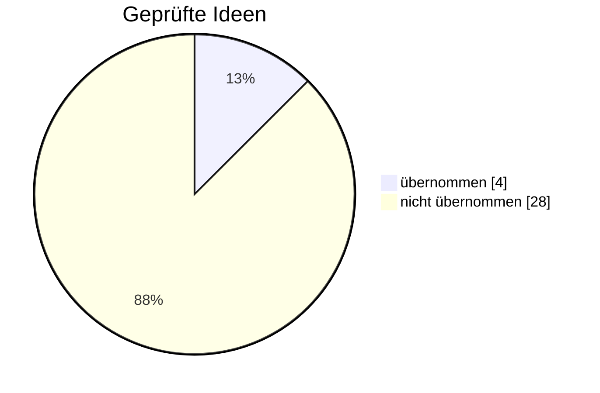

# 🔬 Was der Bot schon weiß

Stand: 30.10.2026 · Simulation mit Spielgeld, keine Anlageberatung.

Alle Ideen, die mit echten Kursen geprüft wurden, auf einen Blick. Diese Notiz ändert der Bot nie. Zurück zur [[Start|Startseite]] · was der Bot aus den eigenen Trades lernt: [[Lehren]].

> [!tip] So wird geprüft
> - **3 Zeiträume** (2010–2014, 2015–2021, 2022–2026) × **2 Aktiengruppen** (Watchlist und 60 andere Aktien) = 6 Fälle.
> - Jeder Fall läuft **16-mal** mit zufälliger Reihenfolge der Aktien, immer mit Gebühr und Spread.
> - **Übernommen wird nur, was überall hilft oder zumindest nirgends erkennbar schadet.**
> - **Pkt** = Prozentpunkte Rendite pro Jahr im Vergleich zum Bot ohne die Idee.

> [!info] 🛡️ Neue Regeln nur geprüft
> Eine Idee kommt erst nach diesem Test und deinem „Ja“ zum Pull Request in den Bot. Der Sicherheits-Check bei GitHub zeigt jede Änderung an den Kaufregeln an.

## ✅ Steckt im Bot

| Idee | Warum |
| --- | --- |
| Stop und Ziel näher (Ziel nicht weiter weg als der Stop) | Trefferquote überall höher (etwa 45 % → 57 %), Rückgänge überall kleiner. Dafür bringt ein Treffer weniger. |
| Höchstens 2 Positionen je Branche | +0,4 Pkt, in 5 von 6 Fällen besser, Rückgang nie größer |
| Lernregel behalten (schlecht laufende Strategien pausieren) | Ganz ohne war es in 4 von 6 Fällen schlechter, eine ruhigere Regel kostete 0,5–0,9 Pkt |
| Shorts aus | Alle Short-Strategien verlieren, auch zehn verbesserte Varianten |

## ❌ Geprüft und nicht übernommen

| Idee | Ergebnis | Mehr dazu |
| --- | --- | --- |
| Weniger Strategien | nur 2 Strategien: −5 Pkt; alle 8 liegen über 16 Jahre im Plus | README |
| Relative Stärke zuerst | leicht schlechter, nicht überall | README |
| Nur klare Signale, Chance-Risiko lernen | half höchstens bis 2021, danach nicht | README |
| Freies Geld im Nasdaq-100 parken | +2 bis +8 Pkt, aber Rückgang bis fast doppelt so groß | README |
| Kaufen nach guten Quartalszahlen | −0,3 Pkt, an 91 % der Tage kauft der Bot ohnehin schon | README |
| Risiko nach der Marktlage (VIX) | −0,6 Pkt | README |
| Gewinner laufen lassen | Rendite nur in der Hälfte der Fälle besser | [[Notizen/Gelernt – Stop nachziehen und absichern]] |
| Halb am Ziel verkaufen, Rest laufen lassen | −1,2 Pkt | [[Notizen/Gelernt – Stop nachziehen und absichern]] |
| Stop während des Trades anheben | −0,7 bis −2,6 Pkt | [[Notizen/Gelernt – Stop nachziehen und absichern]] |
| Verkaufen, wenn überhitzt | −0,9 bis −5,6 Pkt | [[Notizen/Gelernt – Stop nachziehen und absichern]] |
| Ziel-Chance (Black-Scholes) zuerst kaufen | ±0,0 Pkt | [[Notizen/Gelernt aus dem Optionsskript]] |
| Kerzen- und Chartmuster | −0,1 bis −4,1 Pkt | [[Notizen/Gelernt – Muster und Lehrbücher]] |
| Volumen (eigene Strategien oder Filter) | −0,5 bis −1,6 Pkt | [[Notizen/Gelernt – Muster und Lehrbücher]] |
| Lehrbuch-Ideen (ADX, Wochentrend, Fibonacci) | −3,5 bis +0,1 Pkt | [[Notizen/Gelernt – Muster und Lehrbücher]] |
| Mehr Aktien (84 statt 24) | in allen drei Zeiträumen schlechter | README |
| Mehr Positionen (bis 15) | mehr Rendite nur mit mehr Risiko, Rückgang bis 24 % statt 16 % | README |
| Hebel 1,5 bzw. 2 | +4 bzw. +7 Pkt, aber Rückgang etwa doppelt so groß | [[Notizen/Gelernt – Hebel und 4-Stunden-Kerzen]] |
| 4-Stunden-Kerzen statt Tageskerzen | +6,8 % → −1,6 % pro Jahr, doppelte Kosten | [[Notizen/Gelernt – Hebel und 4-Stunden-Kerzen]] |
| TradingView-Strategie „Chart-Muster (Volumen)“ (5-Minuten-Kerzen) | nur bei TSLA im Plus, mit allen 24 Aktien Gewinnfaktor 0,61 mit Gebühren | [[Notizen/Gelernt – Muster und Lehrbücher]] |
| Nachkaufen bei Rückgang, 80 % des Depots für neue Käufe | −0,3 bis −0,5 Pkt, Rückgang in bis zu 4 von 6 Fällen größer | [[Notizen/Gelernt – Nachkaufen, Teilverkauf und 15-Minuten-Chart]] |
| Teil verkaufen beim Markt-Rücksetzer, am Boden zurückkaufen | −0,4 bis +0,1 Pkt, 2022–2026 immer schlechter | [[Notizen/Gelernt – Nachkaufen, Teilverkauf und 15-Minuten-Chart]] |
| 15-Minuten-Wächter beim Verkauf (früher raus beim Drehen, am Ziel laufen lassen) | nirgends verlässlich besser, 2025 bis −3,6 Pkt | [[Notizen/Gelernt – Nachkaufen, Teilverkauf und 15-Minuten-Chart]] |
| Muster-Gedächtnis: ähnliche Charts aus der Vergangenheit (TikTok-Idee) | sagt nichts voraus, bestes Fünftel +0,07 R, schlechtestes +0,10 R | [[Notizen/Gelernt – Muster und Lehrbücher]] |
| Lernmodell: nur Signale mit guter Punktzahl kaufen oder beste zuerst (490.000 Signale, 518 Aktien, mit Bilanzdaten) | Trennschärfe 0,51 (Münzwurf 0,50); beste zuerst −3,1 bis +4,1 Pkt, nicht überall | [[Notizen/Gelernt – Lernmodell und Fehler-Analyse]] |
| Nicht bei jedem Schreck verkaufen (Stop erst zum Schluss, Panik-Regel, starke Aktien halten) | −1,2 bis −5,2 Pkt, nur „starke Aktien“ 2015–2021 +1,8 | [[Notizen/Gelernt – Lernmodell und Fehler-Analyse]] |
| Markt-Ampel aus dem Lernmodell (keine Käufe an schlechten Markttagen) | −0,8 bis +1,0 Pkt, Rückgang etwas kleiner, nicht überall | [[Notizen/Gelernt – Lernmodell und Fehler-Analyse]] |
| Signale am selben Tag vergleichen (Modell ohne Marktlage) | −0,2 bis +0,3 Pkt, Rückgang etwas größer | [[Notizen/Gelernt – Lernmodell und Fehler-Analyse]] |
| 7 statt 5 Positionen | +0,2 Pkt; mit 7 % Gesamtrisiko +1,0 Pkt, aber Rückgang 17,9 % statt 14,2 % (in 6 von 6 Fällen größer) | [[Notizen/Gelernt – Lernmodell und Fehler-Analyse]] |

## ℹ️ Nur zur Info – der Bot handelt nicht danach

- **Ziel-Chance** nach Black-Scholes bei jedem Signal, mit Selbstkontrolle in [[Lehren]]
- **Kerzenmuster** und **Musterziel** bei Ausbrüchen und Doppelböden
- **⚠️ ÜBERHITZT** bei offenen Positionen
- **Lernmodell**: Punktzahl je Kauf-Signal, Fehler-Analyse jedes Trades und was das Modell gelernt hat – im Bericht, auf der Webseite und in [[Lehren]]. Es lernt jeden Monat weiter, entscheidet aber noch nicht.
- **Schlagzeilen**: Nur erkannte schlechte Meldungen verhindern einen Kauf (Nachrichten-Regel). Über 16 Jahre testen lässt sich das nicht, weil es keine alten Schlagzeilen gibt.

## Was die vielen Tests zeigen

- Der Bot hat genug gute Signale. Ihn begrenzt das Risiko pro Trade, nicht die Zahl der Signale. Neue Strategien verdrängen meist nur ähnlich gute Käufe.
- Ideen, die einzelne Trades besser machen, machen das Depot oft nicht besser, weil Plätze und Geld anders genutzt werden.
- Mehr Rendite gab es fast immer nur mit mehr Risiko (Hebel, Nasdaq-100 parken, mehr Positionen). Dann wachsen auch die Rückgänge.
- Zwischendurch eingreifen (nachkaufen, Teile verkaufen, im 15-Minuten-Chart früher raus) kostet Gebühren und bringt im Schnitt nichts. Stop und Ziel, beim Kauf geplant, steuern am besten.
- Einfaches Halten des Nasdaq-100 brachte in den meisten Zeiträumen mehr Rendite, aber mit größeren Rückgängen. Der Vorteil des Bots sind die kleineren Rückgänge.
- Auch ein Lernmodell mit 490.000 gedachten Trades findet kaum Unterschiede zwischen den Signalen. Was es erkennt, ist die Marktlage – und Abstürze des ganzen Markts sind der häufigste Verlustgrund, den keine Regel verlässlich vermeidet.
- Ob der Bot in der Zukunft wirklich etwas taugt, zeigt erst das Übungsdepot: siehe die ehrliche Bilanz im Wochenrückblick.

## Meine Gedanken

