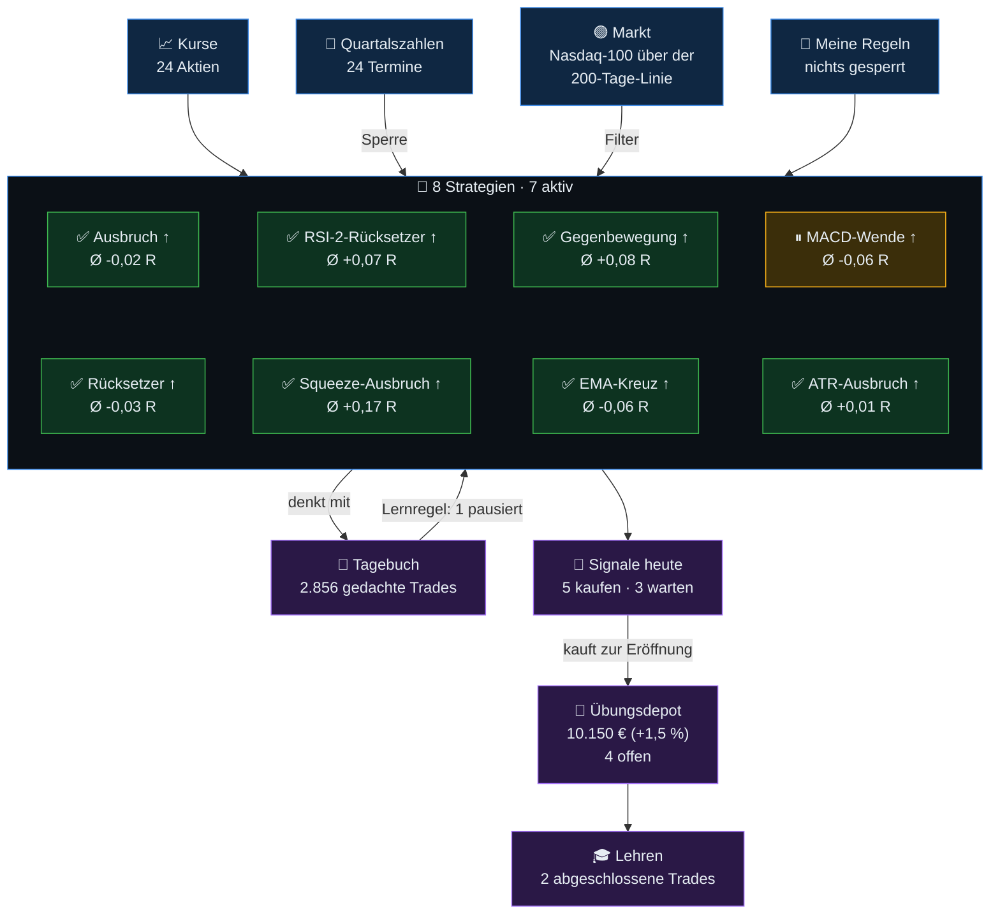

%% BOT-ANFANG – diesen Teil schreibt der Bot bei jedem Lauf neu. %%
# 🧠 Gehirn des Swing-Bots

Stand: Kurse bis Do 29.10.2026 · Simulation mit Spielgeld, keine Anlageberatung.

> [!example] 🔬 [[Notizen/Was der Bot schon weiß|Was der Bot schon weiß]]
> Alle geprüften Ideen auf einen Blick: was übernommen wurde, was nicht und warum.

> [!info]- So funktioniert das Gehirn (antippen zum Aufklappen)
> - Der Bot schreibt nach jedem Lauf: die **Tagesnotiz**, den **Wochenrückblick**, eine Notiz zu **jedem abgeschlossenen Trade** mit dem, was er daraus lernt, und je eine Seite pro **Strategie** und **Aktie**.
> - Er **liest [[Meine Regeln]]**: Dort kannst du Aktien sperren und Strategien ausschalten (Kästchen anhaken, dann hochladen – siehe Anleitung).
> - **Eigene Gedanken** schreibst du am besten in die Trade-Notizen (unter „Meine Gedanken“) oder in eigene Notizen im Ordner `gehirn/Notizen` – die ändert der Bot nie. Die übrigen Seiten schreibt er bei jedem Lauf neu.

## Heute: [[Tage/2026-10-29]] · Diese Woche: [[Wochen/2026-W44|Woche 44]]

- Signale: [[Aktien/HIMS|HIMS]] (🟢 KAUFEN), [[Aktien/SOFI|SOFI]] (🟢 KAUFEN), [[Aktien/MSFT|MSFT]] (🟢 KAUFEN), [[Aktien/JPM|JPM]] (🟢 KAUFEN), [[Aktien/LLY|LLY]] (🟢 KAUFEN)
- 🟢 Marktfilter: Nasdaq-100 (QQQ) schloss am Mi 28.10. über seiner 200-Tage-Linie – der Bot kauft nur (Long).

## Übungsdepot

- 10.150,41 € (+1,5 % seit 2026-10-20) · 4 offen · 2 Trades · Ø +0,28 R · Treffer 100 %
- Letzte Trades: [[Trades/2026-10-21 NOW Squeeze-Ausbruch Long|NOW +0,1 R]], [[Trades/2026-10-21 LLY Squeeze-Ausbruch Long|LLY +0,5 R]]
- Rückblick 12 Monate: -2,6 % (alle Aktien kaufen und halten: -1,0 %)

## Was der Bot gelernt hat → [[Lehren]]

- ✅ aktiv: [[Strategien/Ausbruch Long|Ausbruch ↑]], [[Strategien/RSI-2-Rücksetzer Long|RSI-2-Rücksetzer ↑]], [[Strategien/Gegenbewegung Long|Gegenbewegung ↑]], [[Strategien/Rücksetzer Long|Rücksetzer ↑]], [[Strategien/Squeeze-Ausbruch Long|Squeeze-Ausbruch ↑]], [[Strategien/EMA-Kreuz Long|EMA-Kreuz ↑]], [[Strategien/ATR-Ausbruch Long|ATR-Ausbruch ↑]]
- ⏸ pausiert: [[Strategien/MACD-Wende Long|MACD-Wende ↑]]
- – Short ausgeschaltet: [[Strategien/Abbruch Short|Abbruch ↓]], [[Strategien/RSI-2-Übertreibung Short|RSI-2-Übertreibung ↓]], [[Strategien/Rückfall Short|Rückfall ↓]], [[Strategien/MACD-Wende Short|MACD-Wende ↓]], [[Strategien/Erholung Short|Erholung ↓]], [[Strategien/Squeeze-Abbruch Short|Squeeze-Abbruch ↓]], [[Strategien/EMA-Kreuz Short|EMA-Kreuz ↓]], [[Strategien/ATR-Abbruch Short|ATR-Abbruch ↓]]

## Deine Regeln → [[Meine Regeln]]

- Gesperrte Aktien: keine
- Ausgeschaltete Strategien: keine

## Aktien

[[Aktien/SE|SE]] · [[Aktien/HIMS|HIMS]] · [[Aktien/NOW|NOW]] · [[Aktien/INTU|INTU]] · [[Aktien/CRWV|CRWV]] · [[Aktien/NBIS|NBIS]] · [[Aktien/MELI|MELI]] · [[Aktien/IREN|IREN]] · [[Aktien/NFLX|NFLX]] · [[Aktien/AAPL|AAPL]] · [[Aktien/ASTS|ASTS]] · [[Aktien/SOFI|SOFI]] · [[Aktien/NVDA|NVDA]] · [[Aktien/MSFT|MSFT]] · [[Aktien/AMZN|AMZN]] · [[Aktien/META|META]] · [[Aktien/GOOGL|GOOGL]] · [[Aktien/TSLA|TSLA]] · [[Aktien/AMD|AMD]] · [[Aktien/PLTR|PLTR]] · [[Aktien/JPM|JPM]] · [[Aktien/LLY|LLY]] · [[Aktien/XOM|XOM]] · [[Aktien/COST|COST]]

## Notizen

[[Notizen/Gelernt aus dem Optionsskript|Gelernt aus dem Optionsskript]] · [[Notizen/Gelernt – Hebel und 4-Stunden-Kerzen|Gelernt – Hebel und 4-Stunden-Kerzen]] · [[Notizen/Gelernt – Muster und Lehrbücher|Gelernt – Muster und Lehrbücher]] · [[Notizen/Gelernt – Nachkaufen, Teilverkauf und 15-Minuten-Chart|Gelernt – Nachkaufen, Teilverkauf und 15-Minuten-Chart]] · [[Notizen/Gelernt – Stop nachziehen und absichern|Gelernt – Stop nachziehen und absichern]] · [[Notizen/Was der Bot schon weiß|Was der Bot schon weiß]] · [[Notizen/Wissen – Kerzen- und Chartmuster|Wissen – Kerzen- und Chartmuster]] · [[Notizen/Wissen – Optionen|Wissen – Optionen]] · [[Notizen/Wissen – Traden lernen (Lehrbücher)|Wissen – Traden lernen (Lehrbücher)]]
%% BOT-ENDE %%