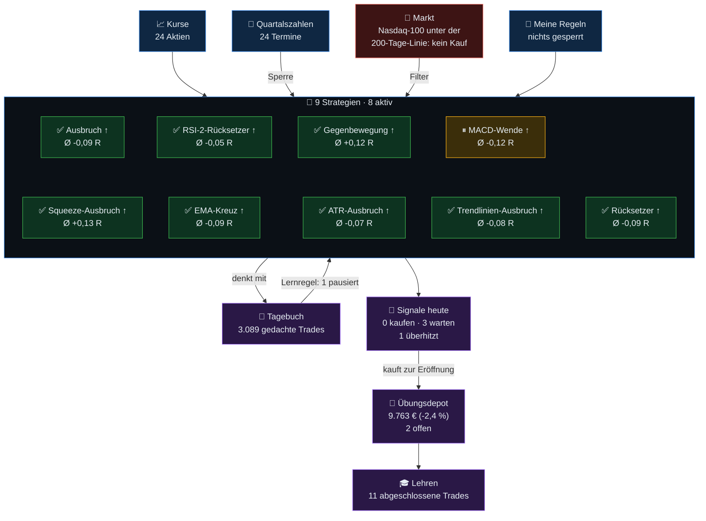

%% BOT-ANFANG – diesen Teil schreibt der Bot bei jedem Lauf neu. %%
# 🧠 Gehirn des Swing-Bots

Stand: Kurse bis Fr 27.11.2026 (vorläufig) · Simulation mit Spielgeld, keine Anlageberatung.

> [!example] 🔬 [[Notizen/Was der Bot schon weiß|Was der Bot schon weiß]]
> Alle geprüften Ideen auf einen Blick: was übernommen wurde, was nicht und warum.

> [!info]- So funktioniert das Gehirn (antippen zum Aufklappen)
> - Der Bot schreibt nach jedem Lauf: die **Tagesnotiz**, den **Wochenrückblick**, eine Notiz zu **jedem abgeschlossenen Trade** mit dem, was er daraus lernt, und je eine Seite pro **Strategie** und **Aktie**.
> - Er **liest [[Meine Regeln]]**: Dort kannst du Aktien sperren und Strategien ausschalten (Kästchen anhaken, dann hochladen – siehe Anleitung).
> - **Eigene Gedanken** schreibst du am besten in die Trade-Notizen (unter „Meine Gedanken“) oder in eigene Notizen im Ordner `gehirn/Notizen` – die ändert der Bot nie. Die übrigen Seiten schreibt er bei jedem Lauf neu.

## Heute: [[Tage/2026-11-27]] · Diese Woche: [[Wochen/2026-W48|Woche 48]]

- Signale: keine
- 🔴 Marktfilter: Nasdaq-100 (QQQ) schloss am Mi 25.11. unter seiner 200-Tage-Linie – der Bot kauft nicht, er wartet ab (Short-Signale sind aus).

## Übungsdepot

- 9.762,96 € (-2,4 % seit 2026-10-20) · 2 offen · 11 Trades · Ø -0,09 R · Treffer 45 %
- Letzte Trades: [[Trades/2026-11-06 COST Ausbruch Long|COST +1,9 R]], [[Trades/2026-10-30 JPM Squeeze-Ausbruch Long|JPM -0,7 R]], [[Trades/2026-11-05 MSFT Ausbruch Long|MSFT -0,8 R]], [[Trades/2026-10-21 INTU ATR-Ausbruch Long|INTU -0,3 R]], [[Trades/2026-10-29 SOFI Ausbruch Long|SOFI -0,9 R]]
- Rückblick 12 Monate: -4,2 % (alle Aktien kaufen und halten: -9,6 %)

## Was der Bot gelernt hat → [[Lehren]]

- ✅ aktiv: [[Strategien/Ausbruch Long|Ausbruch ↑]], [[Strategien/RSI-2-Rücksetzer Long|RSI-2-Rücksetzer ↑]], [[Strategien/Gegenbewegung Long|Gegenbewegung ↑]], [[Strategien/Rücksetzer Long|Rücksetzer ↑]], [[Strategien/Squeeze-Ausbruch Long|Squeeze-Ausbruch ↑]], [[Strategien/EMA-Kreuz Long|EMA-Kreuz ↑]], [[Strategien/ATR-Ausbruch Long|ATR-Ausbruch ↑]], [[Strategien/Trendlinien-Ausbruch Long|Trendlinien-Ausbruch ↑]]
- ⏸ pausiert: [[Strategien/MACD-Wende Long|MACD-Wende ↑]]
- – Short ausgeschaltet: [[Strategien/Abbruch Short|Abbruch ↓]], [[Strategien/RSI-2-Übertreibung Short|RSI-2-Übertreibung ↓]], [[Strategien/Rückfall Short|Rückfall ↓]], [[Strategien/MACD-Wende Short|MACD-Wende ↓]], [[Strategien/Erholung Short|Erholung ↓]], [[Strategien/Squeeze-Abbruch Short|Squeeze-Abbruch ↓]], [[Strategien/EMA-Kreuz Short|EMA-Kreuz ↓]], [[Strategien/ATR-Abbruch Short|ATR-Abbruch ↓]]

## Deine Regeln → [[Meine Regeln]]

- Gesperrte Aktien: keine
- Ausgeschaltete Strategien: keine

## Aktien

[[Aktien/SE|SE]] · [[Aktien/HIMS|HIMS]] · [[Aktien/NOW|NOW]] · [[Aktien/INTU|INTU]] · [[Aktien/CRWV|CRWV]] · [[Aktien/NBIS|NBIS]] · [[Aktien/MELI|MELI]] · [[Aktien/IREN|IREN]] · [[Aktien/NFLX|NFLX]] · [[Aktien/AAPL|AAPL]] · [[Aktien/ASTS|ASTS]] · [[Aktien/SOFI|SOFI]] · [[Aktien/NVDA|NVDA]] · [[Aktien/MSFT|MSFT]] · [[Aktien/AMZN|AMZN]] · [[Aktien/META|META]] · [[Aktien/GOOGL|GOOGL]] · [[Aktien/TSLA|TSLA]] · [[Aktien/AMD|AMD]] · [[Aktien/PLTR|PLTR]] · [[Aktien/JPM|JPM]] · [[Aktien/LLY|LLY]] · [[Aktien/XOM|XOM]] · [[Aktien/COST|COST]]

## Notizen

[[Notizen/Forschung – Tagebuch|Forschung – Tagebuch]] · [[Notizen/Gelernt aus dem Optionsskript|Gelernt aus dem Optionsskript]] · [[Notizen/Gelernt – Hebel und 4-Stunden-Kerzen|Gelernt – Hebel und 4-Stunden-Kerzen]] · [[Notizen/Gelernt – Lernmodell und Fehler-Analyse|Gelernt – Lernmodell und Fehler-Analyse]] · [[Notizen/Gelernt – Muster und Lehrbücher|Gelernt – Muster und Lehrbücher]] · [[Notizen/Gelernt – Nachkaufen, Teilverkauf und 15-Minuten-Chart|Gelernt – Nachkaufen, Teilverkauf und 15-Minuten-Chart]] · [[Notizen/Gelernt – Stop nachziehen und absichern|Gelernt – Stop nachziehen und absichern]] · [[Notizen/Was der Bot schon weiß|Was der Bot schon weiß]] · [[Notizen/Wissen – Day-Trader-Skill|Wissen – Day-Trader-Skill]] · [[Notizen/Wissen – Kerzen- und Chartmuster|Wissen – Kerzen- und Chartmuster]] · [[Notizen/Wissen – Kronos (KI-Zukunftsfächer)|Wissen – Kronos (KI-Zukunftsfächer)]] · [[Notizen/Wissen – Optionen|Wissen – Optionen]] · [[Notizen/Wissen – Traden lernen (Lehrbücher)|Wissen – Traden lernen (Lehrbücher)]]
%% BOT-ENDE %%